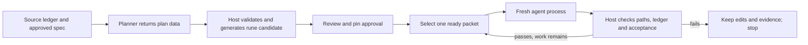

# Design: Local task preparation

Prepare a separate execution ledger from approved source work. Orbit supplies
the planning and validation controls that a smaller model cannot reliably supply
inside an implementation session. Decisions 1–3 define the boundaries.

## Commands and artifacts

```sh
orbit prepare specs/feature/tasks.md --target local \
  --output specs/feature/local-plan --agent codex
orbit prepare specs/feature/tasks.md --target local \
  --output specs/feature/local-plan-v2 --task 1 --from-plan reviewed-plan.json
orbit prepare approve specs/feature/local-plan
orbit local specs/feature/local-plan/tasks.md
orbit run --tasks-file specs/feature/local-plan/tasks.md \
  --variants 2 --variant-agents codex,opus --parallel
```

`--agent` uses existing configured aliases; `--from-plan` imports the same
versioned JSON contract without inference. `--task` limits preparation to one
source subtree and accepts its rune task number or stable marker. Source and
output must resolve inside the same Git worktree, including paths with spaces.
An existing output directory is refused. A sibling temporary directory holds
all generation and readback checks; publish it by rename only on success.

| Artifact under output directory | Contract |
| --- | --- |
| `plan.json` | Validated source obligations, executable items, deferrals and profile |
| `tasks.md` | Rune-created phases; one top-level assignment per phase |
| `packets/<key>.md` | Exact behaviour, relevant context, scope and acceptance for one worker |
| `manifest.json` | Version, source/spec hashes, candidate definition hash, stable task↔packet mapping |
| `review.md` | Source outcome coverage, deferred acceptance, commands, file scopes and prior attempts |
| `approval.json` | Explicit approval of the manifest/definition, created by the approval command |
| `.orbit/attempts/<uuid>/` | Prompt, settings, task snapshots, path changes, validation output and outcome |
| `.gitignore` | Ignores candidate `.orbit/` runtime artifacts |

Candidate frontmatter carries `orbit-prepared: manifest.json`, relative to the
candidate ledger. The marker is detected before agent resolution/dispatch in
both CLI paths. Missing, unsupported, unapproved or stale metadata is an error;
it must never fall back to ordinary phase execution. Manifest and packet paths
must remain within the candidate directory after resolving symlinks.

Approval checks the current source obligations/status snapshot and referenced specification
content, packet bytes and candidate definition. Definition hashes include
canonical task order, stable/numeric identities, titles, phase, details,
references, requirements, streams and dependencies; exclude candidate statuses
and rune owner/claim bookkeeping. Approval therefore survives host-owned progress.
Hash entries store repository-relative paths: a clean fork or variant at the
same revision validates without requiring the original absolute directory.
The approval is a revision pin and review record, not a security signature.

## Work plan contract

Add `internal/workplan` for the versioned plan, validation, rune generation,
approval and packet loading. CLI coordination belongs in `cmd/orbit/prepare.go`.
No new inference client or agent interface is needed.

```text
Plan v1
  source: ledger path + content/definition hashes + selected source identities
  obligations: host-assigned keys, verbatim source details/requirement references
  profile: local-v1
  items[]:
    key, title, behaviour, source_obligations[], depends_on[]
    read_context[]: repository path + bounded excerpt/anchor + reason
    write_paths[]: exact repository-relative files
    prerequisites[]: argv + expected exit/output
    acceptance[]: argv + timeout + expected exit/output
  deferred[]: source_obligation + reason + required owner/provider/browser check
              + blocks_items[] (empty only for later independent acceptance)
  prior_attempts[]: artifact paths + factual stop reasons + retained work
```

The host derives source identities and obligation keys before inference. Use
stable markers from rune canonical Markdown, joined with numeric JSON identities
at that revision. Reject duplicate markers; a legacy task without a marker gets
a revision-scoped path/number identity that becomes stale on source edits.
For each selected source task, assign an obligation key to each detail and each
requirement reference using the source identity and its index in the captured
revision. Keep task-level outcome/title as an obligation too. Never ask the
planner to invent source IDs or change source text. Each selected
task's details and requirement links are shown verbatim in the coverage review.
Constraints remain inherited constraints even when acceptance is deferred.
Completed source work is recorded as context and cannot be reopened by the plan.

Planning runs one selected source task at a time, with approved references,
relevant code context and prior-attempt excerpts. Requests have a positive
timeout and run once. The initial planning adapter is Codex, with hosted or
local inference selected by alias; other planning adapters fail before invocation.
Build a read-only planner configuration from its CLI path, model and a small
allowlist of provider/context/reasoning arguments. Reject sandbox, approval,
arbitrary config, tool/plugin or bypass arguments outside that list; explicitly
set read-only sandboxing and disable planning hooks, apps, search and delegation.
Do not append unvalidated alias extra-args or inherit its auto-approve flag.
Test effective argv and a real sandbox write attempt in a temporary root before
claiming that boundary. Output is JSON data: only host code invokes rune or writes artifacts.
Validate returned source keys against the captured inputs and reject a source
revision that changed during preparation. Retain failed planning output and
diagnostics outside the unpublished candidate; no automatic repair/retry loop.

`local-v1` has a default maximum of three changed source/test/note files per
item, one behaviour, one explicit acceptance checkpoint and no manual service
or browser prerequisites. Ledger status writes and Orbit artifacts do not count
against that file budget. Split RED and GREEN into separate dependent items;
GREEN normally cannot write the preceding test file. The file cap and bounded
context are review aids, not a token estimate or a guarantee of difficulty.
Only this target is implemented; do not create a profile-selection framework.

Check source coverage, all required fields, safe paths, reference anchors,
nonempty commands, dependencies/cycles, gate deferrals and profile limits before
creating rune files. Commands are argv arrays with a repository-relative cwd,
positive timeout and explicit expected result; no implicit shell interpolation.
Use project Makefile commands when available. A RED check names the intended
failing tests/assertions, records a pre-edit baseline and requires declared
failure evidence while excluding missing dependencies, syntax/import failures
and unrelated failures. Preserve baseline evidence across retries with retained
red-test edits; known existing failures need explicit review, not a new baseline
invented by the worker. Nonzero exit alone cannot pass a RED checkpoint.
For RED checks require a reviewed verifier command that consumes captured test
output and returns versioned JSON `{failed_tests:[{name,assertion}],errors:[]}`.
Require exactly the declared failing names and assertion evidence, no error
entries and the declared test-command exit code. Pin verifier file bytes with
approval. Baseline results use the same verifier. Unknown output formats or
missing verifiers prevent a separate RED checkpoint; do not guess failure names
from arbitrary prose. The fixture supplies its verifier. Projects without one
can use one tests-first implementation packet with passing acceptance. Review
must still assess whether the verifier/evidence proves the intended behaviour.

Call rune with explicit paths and check JSON `success`, then read back the
complete ledger and canonical Markdown. Generate new task IDs for all prepared
assignments; source IDs live only in lineage. Never copy original IDs to narrower
outcomes or propagate prepared completion into the original ledger. Cross-file
dependencies become explicit deferred prerequisites with `blocks_items` edges;
references alone do not enforce readiness. Excluding a prerequisite with `--task`
does not satisfy it. Reject executable items depending on an unresolved source
prerequisite; include its executable chain or defer the dependent item.
A prepared run may finish with independent original owner acceptance open.

## Shared prepared-worker execution

Extract the provider-independent selection, prompt, snapshot and progress code
from `internal/orbit/local.go` into an instance scoped to one working directory,
rune client and log manager (`internal/orbit/task_worker.go`). Keep the existing
local preset and ordinary hosted phase loop as entry-point policies. Prepared
execution passes this worker the immutable approved packet loader and validator.
Never put per-variant snapshots or counters on the parent `Orbit` instance.
Prepared execution always selects one packet. Reject `orbit local --phase` and
`--selection model` for prepared ledgers; `--leaf` is redundant but accepted
because generated assignments have no children. Ordinary ledgers retain those
options. This is a distinct host-owned completion policy: do not reuse the local
prompt's model-owned rune mutation instructions.



The work loop takes one ready task, validates approval and prerequisites, checks
STOP/sentinel/ancestor dependencies, creates a fresh UUID, and calls `Agent.Run`
once. It never calls `Resume`, enables native delegation or asks a worker to
retrieve/split the ledger. Default limits match `orbit local`: 20 assignments
and 30 minutes per session; explicit local flags/positive configured alias
timeouts override defaults. Host validation commands have their own positive
timeouts from the approved packet and use the shared process execution cleanup.

Provide only the selected packet, source obligation excerpts, ancestor context
and prior failure summary. The host uses rune to mark work in progress; the
worker receives no ledger mutation commands and must leave every task status
unchanged. The host independently validates the result and alone calls
`rune complete`. Save failed outcomes before success accounting and retain code
edits and in-progress tasks. Worker-written statuses or graph mutations are
failures requiring review, never evidence of completion.
Passing host acceptance also accepts retained work with no new edit; lack of
a diff alone is not a stall. Extract graph checks from `validateLocalProgress`
without applying its model-completes-task condition to prepared workers. Failed
acceptance stops an unchanged worker after one call.

Before and after each session/check, compare file contents for tracked and
non-ignored untracked files, including already-dirty files; Git status alone
cannot detect another edit to a file already marked modified. Allow only the
packet's exact write paths and Orbit artifacts. Only the host may perform ledger
status transitions/automatic ancestor completion. Resolve paths within the current worktree and
reject escaped/symlinked write targets. Generated ignored build/cache files
are outside this diff check; it is a scope check, not an OS security boundary.
Prepare writable dependencies/caches before dispatch.

Codex and Claude Code are the initial prepared-execution adapters. Forward live
writers and process-group cancellation through Claude's existing shared executor,
and set `FinalOutput` from its parsed assistant result for halt detection. Keep
Codex's existing JSONL failure checks. Reject other adapters for prepared ledgers
until they implement and test this contract. Local Codex aliases retain the
existing LM Studio flags/budgets; prepared dispatch supplies the runner controls
that copying flags alone cannot supply. A local alias is not inferred from its name.

Host shell hooks run around the prepared loop. The default `/next-task`/commit
command and AI pre/post prompts are skipped, with the effective policy printed.
Explicit custom AI prompt/command options on prepared runs are rejected before
logs/worktrees. Workers leave edits; an explicit host post-command can commit
declared result paths. Hook warning semantics and comparison judging remain as
documented by [local-run-comparison](../local-run-comparison/smolspec.md).
Check actual result commits and independent acceptance before trusting a report.

### Integration parity

| Existing consumer | Prepared equivalent | Change |
| --- | --- | --- |
| `cmd/orbit/local.go` | Yes | Load prepared marker before logs; retain local model flags and normal-ledger compatibility |
| `cmd/orbit/run.go` | Yes | Validate prepared input and supported aliases before worktrees; retain numeric variant CLI |
| `runSingle` | Yes | Route prepared work to one task-worker instance after host setup |
| `runVariant` | Yes | Rebase ledger, packets and source paths; create one instance per variant |
| `prepareLocalIteration` / `validateLocalProgress` | Yes | Reuse selection/immutable graph checks, adding packet approval and path/host acceptance |
| `runPhaseWithRetry` / `runVariantPhaseWithRetry` | No | Prepared work calls once; ordinary hosted retries remain there |
| `logs.Manager` / registry / variant manager | Yes | Existing statuses, failed attempts and iteration log units; no blocked enum |
| `Agent.Run` / shared executor | Yes | Existing interface; Claude forwards output/cancellation options |
| Comparison / consolidation | No | Existing result consumers; no planner/worker role inferred for the judge |
| Compatibility `local-next-task` | Yes | Continues routing to `localCommand` |

## Resume and evidence

Keep the original source ledger, all preparation revisions and each attempt.
`--from-plan` supports deliberate revisions without another planner call. A new
preparation can reference prior failed plans/attempts but writes a new directory;
approval does not carry forward. Resume of unchanged approved work reads the
actual current ledger, including in-progress tasks, and preserves code edits.
Source specification/ledger definition changes require preparation review;
implementation code changes are expected and do not by themselves stale approval.

Acquire an exclusive per-worktree execution lock at the path returned by
`git rev-parse --git-path orbit-worker.lock`, released on process exit (use the
repository's existing OS-lock pattern). Reject a second
runner instead of racing snapshots; separate variant worktrees remain independent.
All Orbit implementation entry points, including ordinary single/local/variant
runs, acquire this same worktree lock. This excludes cooperating Orbit binaries;
manual edits and older binaries remain outside that guarantee.
Persist a small attempt journal: started → worker-returned → checks-passed →
accepted. Write host validation evidence before calling `rune complete`, then
mark accepted before selecting again. Interrupted validation leaves the task
in progress. On restart recover any unfinished journal before selection, rerun
acceptance if completion/accounting was interrupted, and never skip that check
based only on rune's completed status. If recovery checks fail after a host
completion, uncomplete only that assignment through rune and stop; preserve code.
Pin the initial candidate status snapshot at approval and reconcile every current
status with accepted/recoverable host journals before selection. Unexplained
completion/in-progress changes fail preflight. A relocated progressed candidate
must carry its relative evidence files; otherwise use a fresh pending candidate
materialised from the approved plan, never infer acceptance from copied `[x]`.
Required log/journal storage failures are fatal before inference or completion;
do not inherit the variant loop's best-effort log-manager initialisation policy.
Registry updates remain best effort.

### Programmatic handoff

Each prompt includes an exact, shell-quoted command that atomically writes
`.orbit/attempts/<uuid>/ready.json` with version, attempt UUID and packet digest.
No task mutation or final explanation is needed to signal readiness. The host
observes that one file, validates its identity, and cancels only that worker's
child context/process group before running acceptance against stable files.
This intentional stop is recorded as `ready-handoff`, with the raw CLI exit
retained; it becomes accepted work only after host checks and evidence persist.
Await `Agent.Run` returning and process-group cleanup before inspecting files or
starting checks; unconfirmed shutdown fails the handoff. Latch readiness only
while the attempt is active and before its deadline. Parent/user cancellation
always aborts acceptance; a genuine adapter error is never reclassified merely
because a receipt exists.
Do not classify a readiness-triggered cancellation as an inference timeout or
silently change raw diagnostics. Invalid/stale receipts fail the attempt.

Natural successful worker exit also proceeds to host acceptance. Real adapter
errors, user cancellation and deadlines before valid handoff remain failures.
Record a distinct host-accepted outcome for summary accounting, retaining the
raw worker result separately. Test receipt/exit/deadline races and cancellation
of child tools. This protocol is part of prepared dispatch only.
Count raw usage/duration once, separately from the accepted-work count. Host-only
acceptance creates no inference session. Repeat approval, source/packet integrity,
ledger and prerequisite checks before completion in either acceptance path.

On resume, recheck retained work against its approved acceptance before opening
another worker. Already-satisfied work can be host-completed without inference;
an unfinished check or failed predicate still requires recovery or a fresh worker.

## Risks and assumptions

- Risk: a structurally valid split still requires too much reasoning | Verify: repeat Sanarte's bounded diagnostics trial and a two-behaviour fixture before enlarging scope | If wrong: retain evidence and approve smaller packets, without relaxing outcomes.
- Risk: planning removes a requirement while preserving a coverage key | Verify: adversarial fixture plans plus explicit review of verbatim outcomes against tasks | If wrong: reject the candidate; structural validation cannot replace semantic review.
- Risk: terminating a CLI leaves local inference active | Verify: cancellation fixture and uncontended live probe before longer runs | If wrong: stop long evaluation and repair the adapter; do not reload the shared server.

## Testing strategy

Use real rune and temporary Git repositories with fake agent subprocesses.
Test atomic publication, stale approval, source preservation, stable/numeric ID
joins, paths with spaces, invalid references/cycles/gates and failed rune JSON
with exit zero. Use `rapid` to mutate plans: arbitrary ordering, IDs, dependencies
and status transitions must either validate invariant-preserving structure or
fail without publishing/executing. Test reordering identity mismatches explicitly.

Run two dependent packets through local and single/parallel variant paths.
Verify one process per assignment, unchanged red tests during GREEN, host checks,
dirty/untracked path detection, worker status tampering, interrupted host checks,
repeated resume and independent sibling success. A deliberately bad model must
not turn completed statuses into accepted code. Run `make test-local`,
`make test`, `make lint` and `make build` after integration.

Live procedures and pass/fail fields live in [evaluation.md](evaluation.md).
They are separate from the coding ledger and retain negative results.
